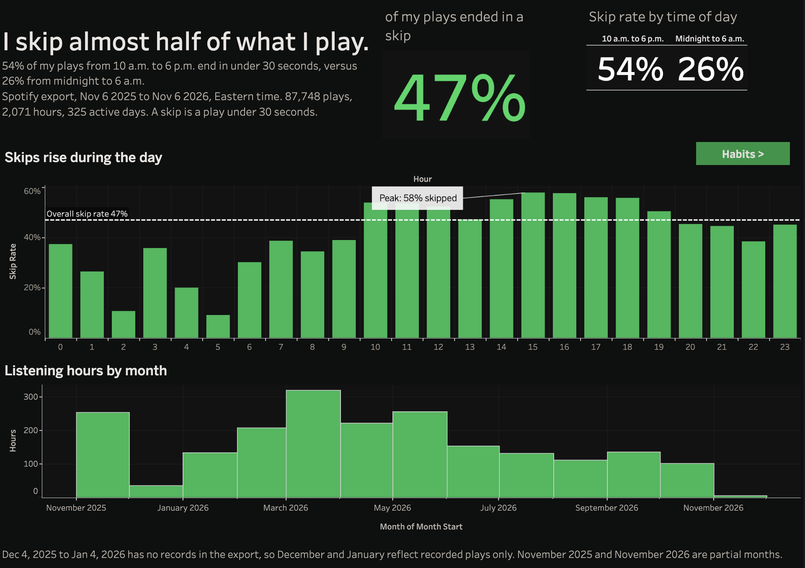
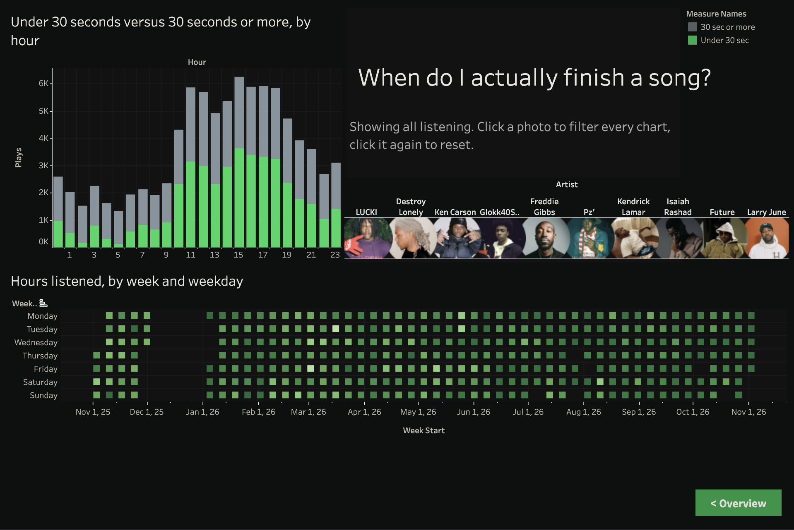

# What My Skips Say About How I Listen

A Tableau Public dashboard built from my own Spotify listening history, with a documented process for how the data was cleaned, validated, and visualized.

**Live dashboard:** https://public.tableau.com/views/Book1_17941744917780/Dashboard1?:language=en-US&:display_count=n

## Overview

I requested my account data from Spotify and analyzed a full year of streaming, from November 6, 2025 to November 6, 2026. The goal was to go past a top artists list and ask a behavior question: when do I explore, and when do I settle in?

## What is in the dashboard

The dashboard has two pages with a dark, Spotify inspired design. The Overview page leads with the main finding (I skip almost half of what I play), the 47% headline skip rate, and the daytime versus overnight comparison, then shows skip rate by hour of day and listening hours by month, with the December gap noted below the chart. The Habits page adds a calendar of listening by week, completed versus skipped streams by hour, and the top 10 artist photos.

The Habits page is interactive. It has a row of my top 10 artists as photos. Clicking a photo filters every chart on that page to that artist, and buttons on each page switch between the two pages.

## Headline numbers

| Metric | Value |
|---|---|
| Hours listened | 2,071 |
| Streams | 87,748 |
| Distinct artists | 2,496 |
| Streams skipped (under 30 seconds) | 47% |
| Average listening per active day | 6.4 hours |

## Key insights

My skip rate depends heavily on the time of day. Between midnight and 5 AM only about 26% of streams are skipped, and at 5 AM it drops to 9%. Between 10 AM and 6 PM it sits near 55%, peaking at 58% around 3 PM. A reasonable reading is that late night listening is settled, familiar music while daytime listening is sampling and searching, though the data shows the pattern and not the reason.

My three most played artists by hours are LUCKI (82 hours), Destroy Lonely (79 hours), and Ken Carson (74 hours). Skip rates vary a lot among artists with at least 300 streams, from about 25% for The Internet to 64% for Yeat, so playing an artist often does not mean finishing their tracks.

Of 2,496 artists, 835 appear only once, which shows how much of my listening is one time discovery.

## How the data was validated

This section is the core of the project. Each step has a matching image in the images folder.

| Step | What I checked | Result |
|---|---|---|
| 1 | Pipeline from raw JSON to dashboard | See 01_pipeline_overview.png |
| 2 | Duplicates, nulls, file count | 0 duplicates, 0 nulls, 9 of 9 files combined |
| 3 | Date coverage | 32 day gap from Dec 4, 2025 to Jan 4, 2026 with zero streams |
| 4 | Stream duration distribution | 47% of streams under 30 seconds, flagged as skips |
| 5 | Timezone | Spotify exports UTC, converted to Eastern so hour of day patterns are accurate |

Decisions I made along the way: the December gap is annotated on the trend chart and not filled in, because the data is missing and not low. Spotify's own definition of a stream is 30 seconds, so shorter plays are flagged as skips and kept in the data. A bucket labeled Unknown Artist (931 streams, 93% skipped) is excluded from artist rankings because it does not represent a real artist.

## How it was visualized

| Step | Chart | Purpose |
|---|---|---|
| 6 | Weekday by hour heatmap | When I listen |
| 7 | Skip rate by hour | The main finding |
| 8 | Monthly hours trend | Change over time, with the data gap marked |
| 9 | Top 10 artists | What I play most, with skip rate in the tooltip |
| 10 | Dashboard layout | How the first four charts fit together |
| 11 | Habits page | Calendar, completed versus skipped by hour, artist photos, and a most played song per artist |
| 12 | Overview page | The finished first page with the headline skip rate, the daytime versus overnight comparison, skip rate by hour, and monthly hours |

## Tech stack

Python and pandas for cleaning and aggregation, matplotlib for the process images, and Tableau Public for the dashboard.

## Repository structure

| Folder or file | Contents |
|---|---|
| scripts | prep.py (clean and combine), agg.py (aggregates and gap check), images.py (process images) |
| data | Aggregated tables only. The raw stream log is excluded for privacy. dashboard_daily.csv is the main table behind every chart (day by hour by artist, top 50 artists plus an "All other artists" bucket). artist_top_song.csv holds each top artist's most played song and play count, and is related to the main table in Tableau by artist name |
| images | The step by step process images and screenshots of both dashboard pages. The artist photo files used for the dashboard are kept out of the repository |
| tableau | Exported workbook (.twbx) |

## Reproduce it

Request your data at spotify.com under Account, Privacy settings, then Download your data. Unzip the export, then run scripts/prep.py with the export folder and an output folder as arguments.

## Limitations

The standard Spotify export covers about one year and has no genre, album, or track ID on each stream, so there is no genre analysis. The December gap could not be explained from the data alone.
